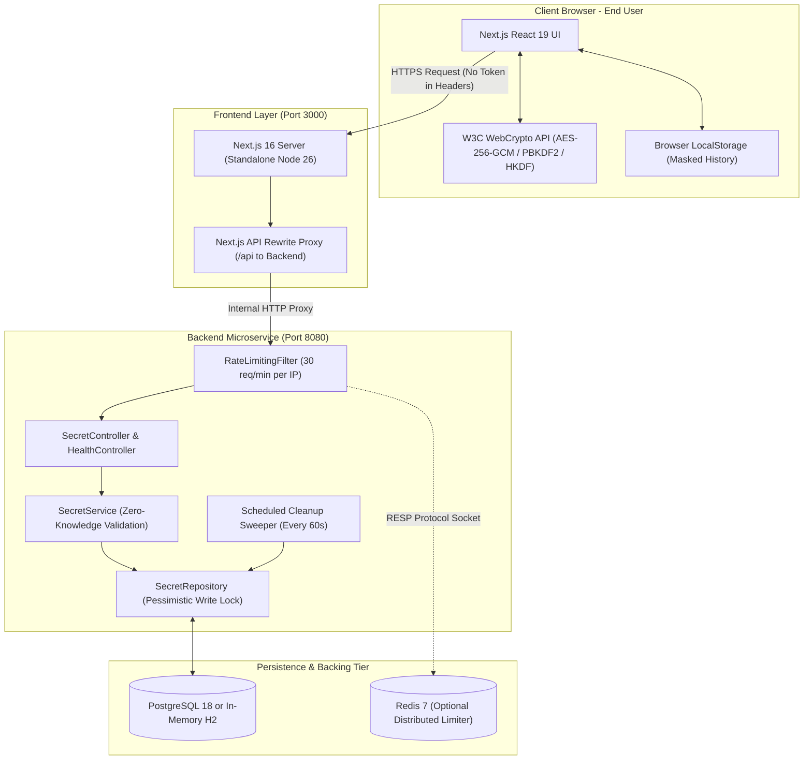
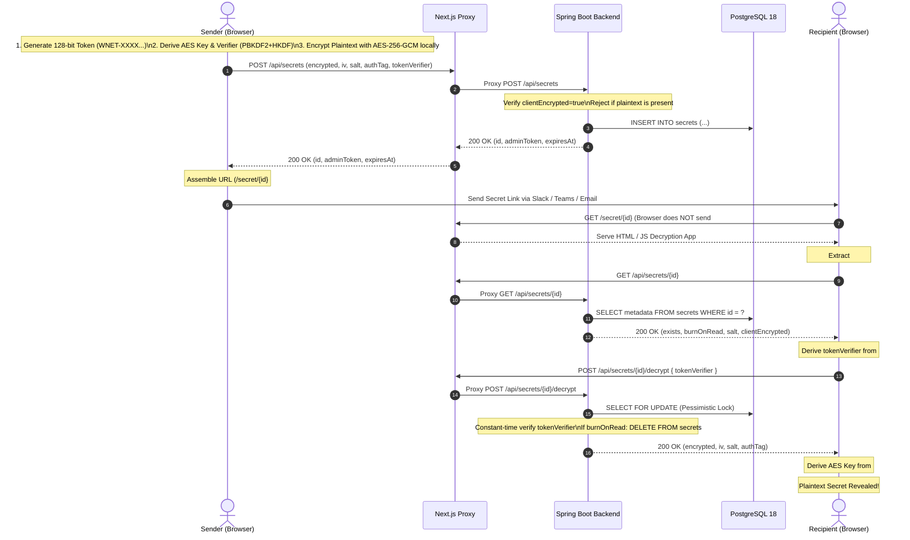
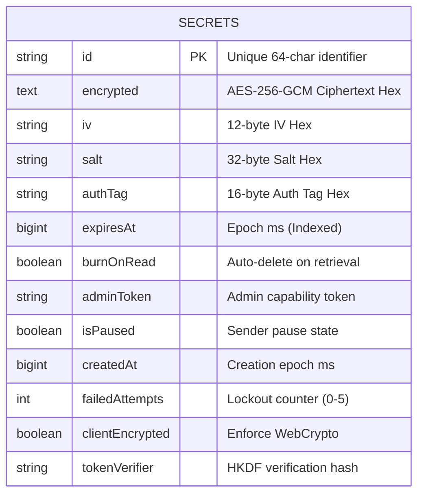

# WhisperNet

> **Zero-Knowledge One-Time Secret Sharing Platform**  
> *End-to-end encrypted secret exchange featuring client-side W3C WebCrypto, URL hash isolation, self-destructing links, anti-burn passphrase verification, and Java Spring Boot persistence.*

[](https://openjdk.org/)
[](https://spring.io/projects/spring-boot)
[](https://nodejs.org/)
[](https://nextjs.org/)
[](https://react.dev/)
[](https://www.typescriptlang.org/)
[](https://tailwindcss.com/)
[](https://www.postgresql.org/)
[](#14-testing)

---

## Table of Contents

- [1. Overview](#1-overview)
- [2. Key Features](#2-key-features)
- [3. Screenshots & Visual Interface](#3-screenshots-visual-interface)
- [4. Technology Stack](#4-technology-stack)
- [5. Project Architecture](#5-project-architecture)
  - [5.1 High-Level Component Topology](#51-high-level-component-topology)
  - [5.2 Zero-Knowledge Sequence Flow](#52-zero-knowledge-sequence-flow)
- [6. Project Structure](#6-project-structure)
- [7. Prerequisites](#7-prerequisites)
- [8. Installation and Setup](#8-installation-and-setup)
  - [8.1 Clone & Repository Navigation](#81-clone-repository-navigation)
  - [8.2 Environment Configuration](#82-environment-configuration)
  - [8.3 Backend Setup (Java 25 & Spring Boot)](#83-backend-setup-java-25-spring-boot)
  - [8.4 Frontend Setup (Next.js 16 & Node 26)](#84-frontend-setup-nextjs-16-node-26)
- [9. Environment Variables](#9-environment-variables)
- [10. Running the Application](#10-running-the-application)
  - [10.1 Local Development Mode](#101-local-development-mode)
  - [10.2 Production Build & Execution](#102-production-build-execution)
  - [10.3 Containerized Execution (Docker Compose)](#103-containerized-execution-docker-compose)
  - [10.4 Available Scripts Summary](#104-available-scripts-summary)
- [11. Application Usage](#11-application-usage)
  - [11.1 Creating a Secret](#111-creating-a-secret)
  - [11.2 Sharing & Distributing Secrets](#112-sharing-distributing-secrets)
  - [11.3 Decrypting a Secret](#113-decrypting-a-secret)
  - [11.4 Sender Management Dashboard](#114-sender-management-dashboard)
- [12. API Documentation](#12-api-documentation)
  - [12.1 POST /api/secrets](#121-post-apisecrets)
  - [12.2 GET /api/secrets/{id}](#122-get-apisecretsid)
  - [12.3 POST /api/secrets/{id}/decrypt](#123-post-apisecretsiddecrypt)
  - [12.4 POST /api/secrets/{id}/manage](#124-post-apisecretsidmanage)
  - [12.5 GET /api/health](#125-get-apihealth)
- [13. Database Documentation](#13-database-documentation)
  - [13.1 Schema & Entity Definition](#131-schema-entity-definition)
  - [13.2 Entity-Relationship Diagram](#132-entity-relationship-diagram)
  - [13.3 Automatic Expiration Sweeper](#133-automatic-expiration-sweeper)
- [14. Testing](#14-testing)
  - [14.1 Backend Test Suite (JUnit 5 & MockMvc)](#141-backend-test-suite-junit-5-mockmvc)
  - [14.2 Frontend Test Suite (Node.js Test Runner)](#142-frontend-test-suite-nodejs-test-runner)
  - [14.3 End-to-End (E2E) Testing (Playwright)](#143-end-to-end-e2e-testing-playwright)
  - [14.4 Code Quality & Linting](#144-code-quality-linting)
- [15. Deployment](#15-deployment)
  - [15.1 Production Docker Orchestration](#151-production-docker-orchestration)
  - [15.2 Managed Cloud Deployment (Aiven PostgreSQL + PaaS)](#152-managed-cloud-deployment-aiven-postgresql-paas)
  - [15.3 JVM & Container Optimization Flags](#153-jvm-container-optimization-flags)
- [16. Troubleshooting](#16-troubleshooting)
- [17. Security Considerations](#17-security-considerations)
- [18. Contributing](#18-contributing)
- [19. License](#19-license)
- [20. Acknowledgements & Credits](#20-acknowledgements-credits)

---

## 1. Overview

**WhisperNet** is a modern, privacy-first secret sharing platform engineered to eliminate the persistent storage of sensitive credentials across corporate communication tools, support ticket queues, and messaging platforms.

In everyday development and IT workflows, sensitive credentials—such as production database passwords, TLS certificates, recovery keys, API tokens, and temporary onboarding credentials—are frequently pasted into Slack, Microsoft Teams, email, or ticketing systems. Once transmitted, these secrets remain permanently indexed, duplicated across backups, accessible to cloud platform administrators, and exposed to third-party data breaches.

WhisperNet enforces a **True Zero-Knowledge** architectural guarantee:
1. **Client-Side Cryptography Exclusively:** Plaintext secrets are encrypted entirely inside the sender's browser using the standardized W3C WebCrypto API (`AES-256-GCM`).
2. **Domain-Separated Key Derivation:** A 128-bit random token is generated client-side. Using `PBKDF2-HMAC-SHA256` (600,000 iterations conforming to NIST SP 800-132) combined with `HKDF-SHA-256`, the browser derives two distinct cryptographic artifacts:
   - An **AES-256 encryption key** (`whispernet-aes-gcm-key-v1`) that never leaves the client browser.
   - A **Salted authentication verifier** (`whispernet-auth-verifier-v1`) sent to the backend so the server can verify decryption authorization without learning the plaintext secret, decryption token, or encryption key.
3. **URL Hash Fragment Isolation:** The decryption token is transmitted strictly after the URL hash fragment (`#token=WNET-...`). Modern RFC 3986 compliant browsers never transmit fragment identifiers in HTTP request headers, ensuring that access logs, proxies, CDN edge servers, and backends remain entirely blind to the secret key.
4. **Authoritative Spring Boot Backend:** A hardened Java 25 / Spring Boot 4.1.2 microservice acts as an encrypted ciphertext vault backed by PostgreSQL 18 or in-memory H2, enforcing pessimistic concurrency locking, sliding-window rate limiting, and automated payload destruction (**Burn-on-Read**).

### Target Audience & Value Proposition
- **DevOps & Cloud Engineers:** Securely transmit ephemeral SSH keys, Kubernetes secrets, and cloud IAM credentials.
- **IT Support & Helpdesk Administrators:** Safely provision one-time passwords to remote end users without leaving email trails.
- **Security-Conscious Teams:** Exchange confidential payloads with mathematical zero-knowledge privacy and verified self-destruction.

---

## 2. Key Features

### Zero-Knowledge Cryptography & Client Isolation
- **Hardware-Accelerated WebCrypto:** Browser-native `AES-256-GCM` with 12-byte random IVs, 16-byte (128-bit) authentication tags, and 32-byte cryptographic salts generated via `crypto.getRandomValues()`.
- **Domain-Separated Dual Derivation:** Uses PBKDF2 (600,000 rounds) and HKDF to mathematically decouple the client encryption key from the server verification token.
- **URL Hash Privacy:** Tokens are formatted as `WNET-XXXXXXXX-XXXXXXXX-XXXXXXXX-XXXXXXXX` and embedded exclusively in the URL hash fragment (`#token=...`), preventing token leakage in server logs.
- **Zero Server-Side Plaintext:** The backend explicitly rejects requests containing raw plaintext secrets or lacking valid client-side encryption parameters (`clientEncrypted: true`) with HTTP 400 Bad Request.

### Lifecycle & Self-Destruction Controls
- **Burn-on-Read Self-Destruction:** Secrets are atomically deleted from the database immediately upon the first successful retrieval.
- **Anti-Burn Passphrase Protection:** If a sender sets a passphrase, the passphrase is bound into the `tokenVerifier`. Submitting an incorrect passphrase causes an authentication failure (`401 Unauthorized`) and decrements the retry counter *without* burning the secret prematurely.
- **Configurable Time-To-Live (TTL):** Senders select expirations of 1 minute (`60s`), 1 hour (`3600s`), 1 day (`86400s`), or 7 days (`604800s`).
- **Automated Sweeper & Lazy Eviction:** Expired records trigger an immediate `410 Gone` on access and are asynchronously pruned every 60 seconds by an automated Spring Boot background job (`@Scheduled(fixedRate = 60000)`).

### Anti-Abuse & Concurrency Hardening
- **5-Attempt Brute-Force Lockout:** Failed decryption attempts increment a persistent counter. Upon the 5th failed attempt, burn-on-read secrets are permanently purged, and multi-read secrets are permanently locked (`429 Too Many Requests`).
- **TOCTOU Race Condition Mitigation:** Decryption and administrative modifications execute within pessimistic write-locked transactions (`@Lock(LockModeType.PESSIMISTIC_WRITE)` / `SELECT ... FOR UPDATE`), preventing Time-Of-Check to Time-Of-Use race conditions during concurrent requests.
- **Sliding-Window Rate Limiting:** Enforces a 30-requests-per-minute per-IP limit via `RateLimitingFilter`, supporting single-instance in-memory tracking or distributed multi-instance clusters via Redis 7.
- **Timing Attack Resistance:** Constant-time byte comparisons via Java `MessageDigest.isEqual` prevent side-channel timing analysis on administrative tokens and verifiers.

### Sender Management & Convenience
- **Administrative Token Controls:** Senders receive a cryptographically random `adminToken` enabling them to pause, resume, or immediately delete active secrets before expiration.
- **Masked Token History:** The "My Secrets History" modal caches only masked token hints (`WNET-1A2B3C4D-••••`) in browser `localStorage`—never storing unmasked decryption keys.
- **Dynamic QR Code Display:** Generated client-side via `react-qr-code` for camera scanning on mobile devices.
- **Desktop Shortcut Download:** Generates a downloadable `.url` desktop shortcut for one-click access.

---

## 3. Screenshots & Visual Interface

The application interface is a dark-mode dashboard built with Tailwind CSS v4 and Lucide React icons.

```
+-----------------------------------------------------------------------------------------+
|  [Logo] WhisperNet                                       [Theme]  [History]  [GitHub]   |
+-----------------------------------------------------------------------------------------+
|                                                                                         |
|                         Share a Secret with Zero-Knowledge                              |
|          Encrypted in your browser. Decrypted in theirs. Burned upon reading.           |
|                                                                                         |
|   +---------------------------------------------------------------------------------+   |
|   | Enter your sensitive text, API key, or private note here...                     |   |
|   |                                                                                 |   |
|   |                                                                                 |   |
|   +---------------------------------------------------------------------------------+   |
|                                                                                         |
|   Lifetime (TTL):  [ 1 Hour (Default) v ]      [x] Burn-on-Read (Delete after viewing)  |
|                                                                                         |
|   [+] Require Decryption Passphrase (Optional)                                          |
|                                                                                         |
|   [                      Create Secret (Encrypt Client-Side)                    ]       |
|                                                                                         |
+-----------------------------------------------------------------------------------------+
|  Output: https://whispernet.app/secret/5a9f...#token=WNET-A1B2-C3D4-E5F6-7890           |
|  [ Copy Secret Link ]       [ View QR Code ]       [ Download Shortcut (.url) ]         |
|  Admin Controls: [ Pause Secret ]  [ Resume Secret ]  [ Destroy Immediately ]           |
+-----------------------------------------------------------------------------------------+
```

Application logo asset: [WhisperNett-main/public/icon.svg](file:///home/pc/colp/busi/WhisperNett-main/public/icon.svg)

---

## 4. Technology Stack

### Frontend (User Interface & Client Encryption)
| Technology | Version | Purpose |
| :--- | :--- | :--- |
| **Next.js** | `16.4.6` | App Router framework, server-side page rendering, and API rewrite proxy |
| **React** | `19.3.1` | Component model, state management, and declarative UI rendering |
| **TypeScript** | `5.9.3` | End-to-end static typing, strict typechecking (`tsc --noEmit`) |
| **Tailwind CSS** | `4.3.5` | Utility-first CSS styling via `@tailwindcss/postcss` and `tw-animate-css` |
| **W3C WebCrypto API** | Native | Browser-native hardware-accelerated `AES-256-GCM`, `PBKDF2`, and `HKDF` |
| **Lucide React** | `1.75.0` | Modern, clean vector iconography |
| **react-qr-code** | `2.2.0` | Client-side dynamic SVG QR code generation |

### Backend (Authoritative REST Microservice)
| Technology | Version | Purpose |
| :--- | :--- | :--- |
| **Java** | `25 LTS` | Modern JVM runtime (`--enable-native-access=ALL-UNNAMED`) |
| **Spring Boot** | `4.1.2` | Enterprise framework, modular starters, and dependency injection |
| **Spring Web MVC** | `4.1.2` | RESTful API controllers, exception handling, and servlet filters |
| **Spring Data JPA** | `4.1.2` | ORM abstraction, Hibernate 7 persistence, and pessimistic write locking |
| **Jakarta Validation** | `3.1.1` | Declarative request payload validation (`@Valid`, `@Size`, `@NotBlank`) |
| **Jackson** | `3.x` | High-performance JSON serialization and deserialization |
| **Bouncy Castle LTS** | `2.73.13` | Cryptographic provider for auxiliary operations (`bcprov-lts8on`) |

### Persistence & Caching
| Technology | Version | Purpose |
| :--- | :--- | :--- |
| **PostgreSQL** | `18 Alpine` | Production relational database, persistent storage of encrypted records |
| **H2 Database** | `2.4.240` | In-memory database for zero-dependency local development and unit tests |
| **HikariCP** | Native | Enterprise JDBC connection pool with cloud/SSL optimization |
| **Redis** | `7 Alpine` | Optional distributed sliding-window rate limiting across multi-node clusters |

### Tooling, Testing & Infrastructure
| Technology | Version | Purpose |
| :--- | :--- | :--- |
| **Apache Maven** | `3.9.x` Wrapper | Java build automation, dependency resolution, and test runner |
| **npm** | `>=11.0.0` | Node.js package management and script execution |
| **Node.js Test Runner** | `node:test` | Native ESM test execution for client crypto and rate limiting |
| **Playwright** | Configured | Cross-browser End-to-End (E2E) integration test runner |
| **ESLint** | `10.0.0` | Static code analysis and frontend style enforcement |
| **Docker & Compose** | `Compose v2/v5` | Multi-stage container builds and microservice orchestration |

---

## 5. Project Architecture

### 5.1 High-Level Component Topology



### 5.2 Zero-Knowledge Sequence Flow



---

## 6. Project Structure

```
.
├── .env.production.example          # Comprehensive production environment template
├── .gitignore                       # Root Git ignore rules (protects builds & secrets)
├── AUDIT_AND_REVIEW.md              # Technical audit, code quality review & test report
├── ENV_UPGRADE_TEST_REPORT.md       # Runtime upgrade validation report
├── MINI_PROJECT_REVIEW.md           # Architecture review and remediation history
├── README.md                        # Master repository documentation (this file)
└── WhisperNett-main/                # Frontend Application & Monorepo Root
    ├── .dockerignore                # Exclusions for Next.js Docker build
    ├── .env.example                 # Local & production environment variables template
    ├── .gitattributes               # Git line endings & checkout configuration
    ├── .gitignore                   # Frontend and backend build output ignore rules
    ├── Dockerfile                   # Multi-stage production build for Next.js frontend
    ├── docker-compose.yml           # Unified orchestration for Next.js + Spring Boot
    ├── eslint.config.mjs            # ESLint 10 flat configuration file
    ├── next.config.ts               # Next.js standalone output and API rewrite configuration
    ├── package.json                 # Node.js ESM manifest ("type": "module")
    ├── playwright.config.ts         # Playwright E2E configuration
    ├── postcss.config.mjs           # PostCSS loader for Tailwind CSS v4
    ├── tsconfig.json                # TypeScript compiler configuration
    ├── tsconfig.tsbuildinfo         # TypeScript incremental build cache
    ├── app/                         # Next.js 16 App Router Directory
    │   ├── globals.css              # Tailwind CSS v4 styling & animations
    │   ├── layout.tsx               # Root layout, theme setup, and SEO metadata
    │   ├── manifest.ts              # Dynamic Progressive Web App (PWA) manifest
    │   ├── page.tsx                 # Main Secret Creation view & Admin dashboard
    │   └── secret/
    │       └── [id]/
    │           └── page.tsx         # Secret Retrieval, Burn-on-Read, & Decryption view
    ├── backend/                     # Java 25 / Spring Boot 4.1.2 REST Microservice
    │   ├── .dockerignore            # Exclusions for Spring Boot Docker build
    │   ├── .env.example             # Backend development environment template
    │   ├── .mvn/                    # Maven wrapper configuration
    │   ├── Dockerfile               # Multi-stage Eclipse Temurin 25 JRE container build
    │   ├── README.md                # Backend-specific architecture guide
    │   ├── docker-compose.yml       # Standalone backend dev compose (Postgres + Redis)
    │   ├── mvnw / mvnw.cmd          # Cross-platform Maven wrapper scripts
    │   ├── pom.xml                  # Maven Project Object Model & dependency tree
    │   └── src/
    │       ├── main/
    │       │   ├── java/com/whispernet/
    │       │   │   ├── WhisperNetApplication.java  # Spring Boot application entrypoint
    │       │   │   ├── config/                     # Filters, CORS, Redis & Exception Handlers
    │       │   │   ├── controller/                 # SecretController & HealthController
    │       │   │   ├── dto/                        # Strongly typed Request & Response DTOs
    │       │   │   ├── model/                      # JPA SecretEntity definition
    │       │   │   ├── repository/                 # Spring Data SecretRepository
    │       │   │   └── service/                    # SecretService & CryptoService logic
    │       │   └── resources/
    │       │       ├── application.yml             # Local dev config (H2 in-memory profile)
    │       │       └── application-prod.yml        # Production profile (PostgreSQL & Hikari)
    │       └── test/java/com/whispernet/           # 19 JUnit 5 & MockMvc unit/integration tests
    ├── components/
    │   └── Header.tsx               # Application header, theme toggle, & history modal
    ├── lib/
    │   ├── client-crypto.ts         # Zero-Knowledge WebCrypto (AES-256-GCM, PBKDF2, HKDF)
    │   └── rate-limiter.ts          # Auxiliary in-memory rate limiter & IP parser
    ├── public/
    │   └── icon.svg                 # Application vector icon
    └── tests/
        ├── client-crypto.test.ts    # WebCrypto unit tests (Node.js test runner)
        ├── rate-limiter.test.ts     # Rate limiter unit tests (Node.js test runner)
        └── e2e-secret-flow.spec.ts  # Playwright E2E end-to-end secret lifecycle tests
```

---

## 7. Prerequisites

Before installing and running the application, ensure your environment meets the following runtime requirements:

| Prerequisite | Minimum Version | Verified Version | Purpose |
| :--- | :--- | :--- | :--- |
| **Node.js** | `>= 26.0.0` | `26.6.6` | Frontend JavaScript runtime & testing |
| **npm** | `>= 11.0.0` | `11.2.0` | Node.js package manager |
| **Java JDK** | `25 LTS` | `OpenJDK 25.0.5` | Backend Java execution & compilation |
| **Apache Maven** | `3.8.7+` | `3.9.16` (Wrapper) | Java build tool & dependency resolution |
| **Docker & Compose** | Docker 24+ / Compose v2+ | Compose `v5.7.0` | Multi-container builds & local deployment |
| **PostgreSQL** *(Prod only)* | `16+` (Target: `18`) | `postgres:18-alpine` | Production relational database persistence |

---

## 8. Installation and Setup

### 8.1 Clone & Repository Navigation

```bash
git clone https://github.com/your-username/whispernet.git
cd whispernet
```

### 8.2 Environment Configuration

Create the root production environment file from the provided example:

```bash
cd WhisperNett-main
cp .env.example .env
```

Edit `.env` to configure your database credentials, CORS origins, and optional Redis rate-limiting settings.

### 8.3 Backend Setup (Java 25 & Spring Boot)

Navigate to the backend directory, verify the Java version, and compile the microservice:

```bash
cd WhisperNett-main/backend

# Verify Java 25 LTS is active
java -version

# Download dependencies and compile
./mvnw clean compile
```

### 8.4 Frontend Setup (Next.js 16 & Node 26)

Navigate to the frontend directory and install the dependencies:

```bash
cd WhisperNett-main

# Install dependencies using clean install
npm ci
```

---

## 9. Environment Variables

The table below documents every environment variable supported across the frontend and backend:

| Variable | Scope | Description | Required | Default / Example Value |
| :--- | :--- | :--- | :--- | :--- |
| `SPRING_PROFILES_ACTIVE` | Backend | Active Spring configuration profile | No | `default` (dev) or `prod` |
| `PORT` | Backend / Frontend | Listening port for the application | No | `8080` (backend) / `3000` (frontend) |
| `SPRING_DATASOURCE_URL` | Backend | JDBC database connection string | **Yes (in prod)** | `jdbc:postgresql://localhost:5432/whispernetdb` |
| `SPRING_DATASOURCE_USERNAME` | Backend | Database user username | **Yes (in prod)** | `whispernet` or `avnadmin` |
| `SPRING_DATASOURCE_PASSWORD` | Backend | Database user password | **Yes (in prod)** | `<your-secure-db-password>` |
| `HIKARI_MAX_POOL_SIZE` | Backend | Maximum HikariCP pool connections | No | `5` (ideal for free/starter cloud tiers) |
| `HIKARI_MIN_IDLE` | Backend | Minimum idle connections in pool | No | `1` |
| `WHISPERNET_CORS_ALLOWED_ORIGINS` | Backend | Comma-separated list of allowed origins | No | `http://localhost:3000,http://127.0.0.1:3000` |
| `TRUST_PROXY_HEADERS` | Backend | Trust `X-Forwarded-For` for IP extraction | No | `true` (if behind reverse proxy), else `false` |
| `RATE_LIMIT_MAX_REQUESTS` | Backend | Maximum requests allowed per IP window | No | `30` |
| `RATE_LIMIT_WINDOW_SECONDS` | Backend | Duration of rate limiting window in seconds | No | `60` |
| `REDIS_ENABLED` | Backend | Enable distributed Redis rate limiter | No | `false` (uses in-memory limiter) |
| `REDIS_HOST` | Backend | Redis hostname or IP | Conditional | `localhost` |
| `REDIS_PORT` | Backend | Redis port | Conditional | `6379` |
| `REDIS_PASSWORD` | Backend | Redis authentication password | No | `<optional-redis-password>` |
| `REDIS_USER` | Backend | Redis ACL user | No | `default` |
| `REDIS_SSL` | Backend | Enable TLS/SSL connection to Redis | No | `false` |
| `REDIS_FAIL_CLOSED` | Backend | Fail-closed policy if Redis connection fails | No | `true` |
| `SPRING_BOOT_BACKEND_URL` | Frontend | Target URL for Next.js `/api/*` rewrite proxy | No | `http://127.0.0.1:8080` |
| `NODE_ENV` | Frontend | Node execution environment | No | `development` or `production` |
| `NEXT_TELEMETRY_DISABLED` | Frontend | Disable Next.js anonymous telemetry | No | `1` |

---

## 10. Running the Application

### 10.1 Local Development Mode

To run WhisperNet locally with zero external dependencies (using an in-memory H2 database):

#### Terminal 1 — Start Java Spring Boot Backend:
```bash
cd WhisperNett-main/backend
./mvnw spring-boot:run
```
- **Backend API:** Available at `http://localhost:8080`
- **H2 Console:** Accessible at `http://localhost:8080/h2-console` (`JDBC URL: jdbc:h2:mem:whispernetdb`, User: `sa`, Password: *blank*)

#### Terminal 2 — Start Next.js Frontend:
```bash
cd WhisperNett-main
npm run dev
```
- **Frontend Web UI:** Accessible at `http://localhost:3000`
- Next.js automatically rewrites all `/api/*` client requests to `http://127.0.0.1:8080/api/*`.

---

### 10.2 Production Build & Execution

#### Build & Run Backend:
```bash
cd WhisperNett-main/backend
./mvnw clean package -DskipTests
java --enable-native-access=ALL-UNNAMED -Dspring.profiles.active=prod -jar target/whispernet-backend-1.0.0.jar
```

#### Build & Run Frontend:
```bash
cd WhisperNett-main
npm run build
npm start
```

---

### 10.3 Containerized Execution (Docker Compose)

The production Docker Compose configuration automatically boots the Next.js frontend, Spring Boot backend, and health check monitoring.

```bash
cd WhisperNett-main

# Ensure .env is populated with database credentials
cp .env.example .env
nano .env

# Build and start all services in detached mode
docker compose up -d --build
```

#### Verifying Service Health:
```bash
docker compose ps
curl -s http://127.0.0.1:8080/api/health
```

---

### 10.4 Available Scripts Summary

#### Frontend (`WhisperNett-main/package.json`):
- `npm run dev`: Starts Next.js development server on port 3000.
- `npm run build`: Compiles production Next.js standalone application.
- `npm start`: Starts production Next.js server.
- `npm run lint`: Runs ESLint 10 code quality checks.
- `npm run typecheck`: Runs TypeScript 5.9 compiler check (`tsc --noEmit`).
- `npm test`: Executes native Node.js unit tests (`tests/client-crypto.test.ts`, `tests/rate-limiter.test.ts`).
- `npm run test:e2e`: Runs Playwright end-to-end integration tests.

#### Backend (`WhisperNett-main/backend/pom.xml`):
- `./mvnw clean compile`: Compiles all Java 25 source files.
- `./mvnw test`: Executes all 19 JUnit 5 and MockMvc tests.
- `./mvnw package`: Packages the standalone executable JAR (`target/whispernet-backend-1.0.0.jar`).
- `./mvnw spring-boot:run`: Launches the Spring Boot development server.

---

## 11. Application Usage

### 11.1 Creating a Secret
1. Open `http://localhost:3000` in any modern web browser.
2. Enter your sensitive message or credentials into the secret textarea.
3. Select an expiration window:
   - **1 Minute** (rapid ephemeral delivery)
   - **1 Hour** (recommended default)
   - **1 Day**
   - **7 Days**
4. Choose whether to enable **Burn-on-Read** (defaults to enabled).
5. *(Optional)* Provide a custom decryption passphrase to protect against unauthorized link interception.
6. Click **Create Secret**. The browser generates the 128-bit token, derives the keys, encrypts the payload via WebCrypto, and uploads only the ciphertext and salted verifier to the backend.

### 11.2 Sharing & Distributing Secrets
Upon creation, the UI displays:
- **Shareable Link:** E.g., `https://whispernet.app/secret/5a9f3b8c...#token=WNET-A1B2-C3D4-E5F6-7890`.
- **Copy Link Button:** Copies the full URL with hash fragment to the system clipboard.
- **Dynamic QR Code:** Enables mobile phone camera scanning for air-gapped device transfer.
- **Desktop Shortcut:** Downloads an OS-compatible `.url` shortcut.

### 11.3 Decrypting a Secret
1. When the recipient opens the link, the browser reads `#token=WNET-...` from `window.location.hash` and instantly scrubs the address bar via `window.history.replaceState` to prevent token retention in browser history.
2. The page queries `GET /api/secrets/{id}` to verify existence and fetch the cryptographic salt.
3. If protected by a passphrase, the user is prompted to input it.
4. The browser computes `tokenVerifier` and dispatches `POST /api/secrets/{id}/decrypt`.
5. Upon successful verification, the backend returns the ciphertext (and burns the record if Burn-on-Read is set).
6. The browser decrypts the ciphertext locally and reveals the plaintext secret with a one-click copy button.

### 11.4 Sender Management Dashboard
Senders retain full control over their active secrets via the generated `adminToken`:
- **Pause Secret:** Temporarily locks retrieval (`403 Forbidden`).
- **Resume Secret:** Re-enables decryption access.
- **Destroy Immediately:** Irrevocably purges the secret from the database before its natural expiration.
- **Secret History:** Open the "History" modal from the header to view past created secrets, masked tokens (`WNET-XXXX-••••`), and live statuses stored locally in the browser.

---

## 12. API Documentation

Base URL: `http://localhost:8080/api` (or proxied via `http://localhost:3000/api`)

All request and response bodies use standard `application/json` content types.

---

### 12.1 POST /api/secrets
Stores a client-encrypted secret payload.

#### Request Headers:
`Content-Type: application/json`

#### Request Body Example:
```json
{
  "clientEncrypted": true,
  "encrypted": "4a7f9b2c8d1e3f...",
  "iv": "e0b1c2d3e4f5a6b7c8d9e0f1",
  "salt": "a1b2c3d4e5f6a1b2c3d4e5f6a1b2c3d4e5f6a1b2c3d4e5f6a1b2c3d4e5f6a1b2",
  "authTag": "f1e2d3c4b5a6f1e2d3c4b5a6f1e2d3c4",
  "tokenVerifier": "7b8c9d0e1f2a3b4c5d6e7f8a9b0c1d2e3f4a5b6c7d8e9f0a1b2c3d4e5f6a7b8c",
  "expiration": 3600,
  "burnOnRead": true
}
```

#### Response Example (`200 OK`):
```json
{
  "id": "5a9f3b8c2d1e4f0a9b8c7d6e5f4a3b2c",
  "expiresAt": 1773900000000,
  "adminToken": "e1f2a3b4c5d6e7f8a9b0c1d2e3f4a5b6",
  "clientEncrypted": true
}
```

#### Error Responses:
- `400 Bad Request`: Transmitting raw plaintext `"secret"` or omitting required cryptographic parameters.

---

### 12.2 GET /api/secrets/{id}
Retrieves non-sensitive metadata for a secret.

#### Response Example (`200 OK`):
```json
{
  "exists": true,
  "expiresAt": 1773900000000,
  "burnOnRead": true,
  "isPaused": false,
  "clientEncrypted": true,
  "salt": "a1b2c3d4e5f6a1b2c3d4e5f6a1b2c3d4e5f6a1b2c3d4e5f6a1b2c3d4e5f6a1b2"
}
```

#### Error Responses:
- `404 Not Found`: Secret does not exist or has already been burned.
- `410 Gone`: Secret has passed its expiration time.

---

### 12.3 POST /api/secrets/{id}/decrypt
Verifies the caller's authorization verifier and returns the ciphertext.

#### Request Body Example:
```json
{
  "tokenVerifier": "7b8c9d0e1f2a3b4c5d6e7f8a9b0c1d2e3f4a5b6c7d8e9f0a1b2c3d4e5f6a7b8c"
}
```

#### Response Example (`200 OK`):
```json
{
  "clientEncrypted": true,
  "encrypted": "4a7f9b2c8d1e3f...",
  "iv": "e0b1c2d3e4f5a6b7c8d9e0f1",
  "salt": "a1b2c3d4e5f6a1b2c3d4e5f6a1b2c3d4e5f6a1b2c3d4e5f6a1b2c3d4e5f6a1b2",
  "authTag": "f1e2d3c4b5a6f1e2d3c4b5a6f1e2d3c4"
}
```

#### Error Responses:
- `401 Unauthorized`: Invalid `tokenVerifier` (wrong token or incorrect passphrase). Includes attempts remaining: `Invalid token or passphrase (4 attempts remaining)`.
- `403 Forbidden`: Secret is currently paused by sender.
- `404 Not Found`: Secret not found or destroyed.
- `410 Gone`: Secret expired.
- `429 Too Many Requests`: Maximum attempts exceeded (secret locked or destroyed).

---

### 12.4 POST /api/secrets/{id}/manage
Performs sender administrative actions (`pause`, `resume`, `delete`).

#### Request Body Example:
```json
{
  "adminToken": "e1f2a3b4c5d6e7f8a9b0c1d2e3f4a5b6",
  "action": "pause"
}
```

#### Response Example (`200 OK`):
```json
{
  "success": true,
  "isPaused": true
}
```
*(When action is `delete`, returns `{"success": true, "deleted": true}`)*

#### Error Responses:
- `400 Bad Request`: Missing token or invalid action.
- `403 Forbidden`: Invalid `adminToken`.
- `404 Not Found`: Secret not found.
- `410 Gone`: Secret expired.

---

### 12.5 GET /api/health
Service health check endpoint.

#### Response Example (`200 OK`):
```json
{
  "status": "UP",
  "service": "whispernet-backend",
  "timestamp": 1773898800000
}
```

---

## 13. Database Documentation

### 13.1 Schema & Entity Definition

The backend uses a single, highly optimized, non-relational table named `secrets`. Storing no foreign key relations maximizes read/write throughput and guarantees atomic row deletion.

| Column | Data Type | Nullable | Constraints / Default | Description |
| :--- | :--- | :--- | :--- | :--- |
| `id` | `VARCHAR(64)` | No | `PRIMARY KEY` | Cryptographically random unique identifier |
| `encrypted` | `TEXT` | No | Max 200,000 hex chars | WebCrypto AES-256-GCM ciphertext hex |
| `iv` | `VARCHAR(64)` | No | 12 bytes (24 hex) | Initialization Vector hex |
| `salt` | `VARCHAR(128)` | No | 32 bytes (64 hex) | Cryptographic salt hex |
| `authTag` | `VARCHAR(64)` | No | 16 bytes (32 hex) | GCM authentication tag hex |
| `expiresAt` | `BIGINT` | No | Indexed (`idx_secrets_expires_at`) | Expiration epoch timestamp (milliseconds) |
| `burnOnRead` | `BOOLEAN` | No | Default `true` | Self-destruct flag upon successful decryption |
| `adminToken` | `VARCHAR(64)` | No | Constant-time checked | Administrative control authorization token |
| `isPaused` | `BOOLEAN` | No | Default `false` | Sender pause state flag |
| `createdAt` | `BIGINT` | No | Epoch ms | Creation epoch timestamp |
| `failedAttempts`| `INT` | No | Default `0` | Failed decryption attempt counter (max 5) |
| `clientEncrypted`| `BOOLEAN`| No | Default `true` | Enforces zero-knowledge client encryption |
| `tokenVerifier` | `VARCHAR(128)`| Yes | 32 bytes (64 hex) | Salted HKDF-derived verification hash |

### 13.2 Entity-Relationship Diagram



### 13.3 Automatic Expiration Sweeper

In addition to lazy deletion upon access (`410 Gone`), Spring Boot executes a scheduled background task every 60 seconds:

```java
@Scheduled(fixedRate = 60000)
@Transactional
public void cleanExpiredSecrets() {
    secretRepository.deleteByExpiresAtLessThan(System.currentTimeMillis());
}
```

---

## 14. Testing

WhisperNet maintains comprehensive test coverage across all layers of the application, with **29 automated tests passing** with zero failures or errors.

### 14.1 Backend Test Suite (JUnit 5 & MockMvc)

The backend test suite verifies REST endpoints, zero-knowledge constraints, database persistence, pessimistic locking, rate limiting, and exception handlers.

```bash
cd WhisperNett-main/backend
./mvnw test
```

#### Test Execution Report:
- `com.whispernet.controller.SecretControllerTest`: **11 tests** (passed)
  - Rejection of plaintext secrets (`400 Bad Request`)
  - Valid client-encrypted secret creation
  - Retrieval of metadata and salt
  - Token verifier decryption with burn-on-read
  - Rejection of wrong token verifier (`401 Unauthorized`)
  - Failed attempts decrement & lockout (`429 Too Many Requests`)
  - Admin pause, resume, and delete workflows
  - Expired secret handling (`410 Gone`)
- `com.whispernet.controller.HealthControllerTest`: **3 tests** (passed)
  - Health check status UP verification (`GET /api/health`)
  - Root probe verification (`GET /` and `HEAD /` for cloud PaaS like Render/Railway)
  - Non-existent resource handling (returns `404 Not Found` without unhandled server exception)
- `com.whispernet.config.RedisRateLimiterTest`: **3 tests** (passed)
  - Sliding-window enforcement and socket failover
- `com.whispernet.service.CryptoServiceTest`: **4 tests** (passed)
  - ID and admin token entropy generation

**Backend Total: 21 Tests Run, 21 Passed, 0 Failures, 0 Errors.**

---

### 14.2 Frontend Test Suite (Node.js Test Runner)

Frontend cryptographic operations and client rate limiting are tested natively using the Node.js test runner with zero third-party testing dependencies.

```bash
cd WhisperNett-main
npm test
```

#### Test Execution Report:
- `tests/client-crypto.test.ts`: **5 tests** (passed)
  - 128-bit uppercase token generation in `WNET-XXXX-XXXX-XXXX-XXXX` format
  - Hex conversion and validation
  - Full WebCrypto `AES-256-GCM` round-trip encryption and decryption
  - Passphrase binding (wrong passphrase produces mismatched verifier, preventing premature burn)
  - Rejection of tampered ciphertexts, auth tags, or invalid tokens
- `tests/rate-limiter.test.ts`: **3 tests** (passed)
  - Sliding-window allowance up to max requests
  - Memory bounding and key isolation
  - `X-Forwarded-For` header isolation under proxy settings

**Frontend Total: 8 Tests Run, 8 Passed, 0 Failures.**

---

### 14.3 End-to-End (E2E) Testing (Playwright)

An end-to-end test suite tests the full lifecycle in real browsers:
- File: [WhisperNett-main/tests/e2e-secret-flow.spec.ts](file:///home/pc/colp/busi/WhisperNett-main/tests/e2e-secret-flow.spec.ts)
- Config: [WhisperNett-main/playwright.config.ts](file:///home/pc/colp/busi/WhisperNett-main/playwright.config.ts)

```bash
cd WhisperNett-main
npm run test:e2e
```

---

### 14.4 Code Quality & Linting

```bash
cd WhisperNett-main

# TypeScript compiler check
npm run typecheck

# ESLint check
npm run lint
```
- **Typecheck Result:** 0 errors (`tsc --noEmit`).
- **ESLint Result:** 0 errors, 0 warnings.

---

## 15. Deployment

### 15.1 Production Docker Orchestration

The root multi-service configuration is defined in [WhisperNett-main/docker-compose.yml](file:///home/pc/colp/busi/WhisperNett-main/docker-compose.yml):

```yaml
services:
  whispernet-backend:
    build:
      context: ./backend
      dockerfile: Dockerfile
    container_name: whispernet-backend
    restart: unless-stopped
    ports:
      - "127.0.0.1:8080:8080"
    environment:
      - SPRING_PROFILES_ACTIVE=prod
      - PORT=8080
      - SPRING_DATASOURCE_URL=${SPRING_DATASOURCE_URL}
      - SPRING_DATASOURCE_USERNAME=${SPRING_DATASOURCE_USERNAME}
      - SPRING_DATASOURCE_PASSWORD=${SPRING_DATASOURCE_PASSWORD}
      - HIKARI_MAX_POOL_SIZE=${HIKARI_MAX_POOL_SIZE:-5}
      - HIKARI_MIN_IDLE=${HIKARI_MIN_IDLE:-1}
      - WHISPERNET_CORS_ALLOWED_ORIGINS=${WHISPERNET_CORS_ALLOWED_ORIGINS:-http://localhost:3000}
      - TRUST_PROXY_HEADERS=${TRUST_PROXY_HEADERS:-true}
      - REDIS_ENABLED=${REDIS_ENABLED:-false}
    healthcheck:
      test: ["CMD-SHELL", "wget --no-verbose --tries=1 --spider http://127.0.0.1:8080/api/health || exit 1"]
      interval: 10s
      timeout: 5s
      retries: 5
      start_period: 25s

  whispernet-frontend:
    build:
      context: .
      dockerfile: Dockerfile
    container_name: whispernet-frontend
    restart: unless-stopped
    depends_on:
      whispernet-backend:
        condition: service_healthy
    ports:
      - "3000:3000"
    environment:
      - NODE_ENV=production
      - PORT=3000
      - SPRING_BOOT_BACKEND_URL=http://whispernet-backend:8080
    healthcheck:
      test: ["CMD-SHELL", "wget --no-verbose --tries=1 --spider http://127.0.0.1:3000/ || exit 1"]
      interval: 10s
      timeout: 5s
      retries: 3
      start_period: 15s
```

---

### 15.2 Managed Cloud Deployment (Aiven PostgreSQL + PaaS)

WhisperNet is pre-configured to support managed cloud databases such as **Aiven PostgreSQL**:

1. **Database URL:**  
   `jdbc:postgresql://<aiven-host>:<aiven-port>/whisper_net?sslmode=require`
2. **HikariCP Tuning for Cloud Tiers:**  
   To prevent exhausting small connection pools on free/starter tiers, set `HIKARI_MAX_POOL_SIZE=5` and `HIKARI_MIN_IDLE=1`.
3. **PaaS Hosting:**
   - **Frontend (Next.js):** Deploy to Vercel, Railway, or Render with Root Directory set to `WhisperNett-main` and `SPRING_BOOT_BACKEND_URL` pointing to your Spring Boot service.
   - **Backend (Spring Boot):** Deploy the multi-stage `backend/Dockerfile` to Railway, Render, Fly.io, or AWS ECS.

---

### 15.3 JVM & Container Optimization Flags

The backend `Dockerfile` enforces container-aware memory allocation flags:
```dockerfile
ENTRYPOINT ["sh", "-c", "exec java --enable-native-access=ALL-UNNAMED -XX:+UseContainerSupport -XX:MaxRAMPercentage=75.0 -XX:+ExitOnOutOfMemoryError ${JAVA_OPTS} -jar app.jar"]
```
- `-XX:+UseContainerSupport`: Automatically sizes JVM memory according to cgroups limits.
- `-XX:MaxRAMPercentage=75.0`: Prevents container OOM killer evictions by reserving 25% of container RAM for OS and native JVM buffers.
- `-XX:+ExitOnOutOfMemoryError`: Halts the JVM immediately on OOM so the container orchestrator restarts the service cleanly.

---

## 16. Troubleshooting

### 1. Database Password Error on Docker Compose
- **Symptom:** Docker Compose fails with `Set SPRING_DATASOURCE_PASSWORD in .env`.
- **Cause:** Production compose enforces that database credentials must not be left blank.
- **Solution:** Copy `.env.example` to `.env` in `WhisperNett-main/` and provide your database password before running `docker compose up`.

### 2. Backend Fails to Start (Port 8080 Conflict)
- **Symptom:** `Web server failed to start. Port 8080 was already in use.`
- **Solution:** Stop conflicting processes using `lsof -i :8080` or pass a custom port:
  ```bash
  PORT=8081 ./mvnw spring-boot:run
  ```
  Update `SPRING_BOOT_BACKEND_URL=http://127.0.0.1:8081` in your frontend configuration.

### 3. Java 25 Native Access Warnings
- **Symptom:** `WARNING: A terminally deprecated method in sun.misc.Unsafe has been called`
- **Explanation:** Modern Java 25 warns on direct memory access. WhisperNet supplies `--enable-native-access=ALL-UNNAMED` in `mvnw` surefire and the Dockerfile entrypoint to ensure full compatibility.

### 4. Client Decryption Returns "401 Unauthorized"
- **Symptom:** Decryption fails with `Invalid token or passphrase (X attempts remaining)`.
- **Cause:** The URL token has been truncated or the entered passphrase does not match the one used during creation.
- **Note:** The secret will be destroyed if 5 consecutive failed attempts occur.

### 5. Secret Shows "410 Gone" Immediately
- **Symptom:** Recipient accesses secret and receives an expired error.
- **Cause:** The secret's configured TTL (e.g., 1 minute) has elapsed, or the server's clock is skewed. Ensure NTP synchronization is enabled on your host.

---

## 17. Security Considerations

1. **Zero Knowledge by Design:** Decryption keys never touch the network or the backend. Plaintext secrets are strictly unrecoverable by the database administrator or hosting provider.
2. **NIST SP 800-132 Compliance:** Key derivation uses 600,000 PBKDF2 iterations to resist GPU-based offline dictionary attacks on passphrases.
3. **No Secret Tokens in Access Logs:** Decryption tokens are stored in the URL hash fragment (`#token=...`), which RFC 3986 forbids browsers from transmitting in HTTP requests.
4. **Race-Condition Immune:** JPA pessimistic write locking (`SELECT ... FOR UPDATE`) prevents concurrent double-reads of burn-on-read secrets.
5. **No Plaintext Fallback:** Server-side encryption is disabled; requests attempting to send unencrypted text are rejected with HTTP 400.
6. **Reverse Proxy Security:** `RateLimitingFilter` only inspects `X-Forwarded-For` when `TRUST_PROXY_HEADERS=true` is explicitly configured, mitigating IP spoofing attacks.

---

## 18. Contributing

Contributions are welcomed. Please follow this standard contribution workflow:

1. **Fork the Repository:** Create a personal fork on GitHub.
2. **Create a Feature Branch:**
   ```bash
   git checkout -b feature/your-feature-name
   ```
3. **Commit Your Changes:** Keep commit messages descriptive and clear.
4. **Run Test Suites:** Verify that all automated tests pass:
   ```bash
   cd WhisperNett-main
   npm test
   npm run lint
   npm run typecheck
   cd backend && ./mvnw test
   ```
5. **Submit a Pull Request:** Open a PR against the `main` branch with a summary of changes.

---

## 19. License

No license has been specified for this project yet. All rights are reserved by the original authors unless explicitly stated otherwise in writing.

---

## 20. Acknowledgements & Credits

- [W3C Web Cryptography API](https://www.w3.org/TR/WebCryptoAPI/) for hardware-accelerated browser encryption.
- [Spring Boot Team](https://spring.io/projects/spring-boot) for the enterprise Java framework.
- [Next.js Team at Vercel](https://nextjs.org/) for the modern React framework.
- [Bouncy Castle Project](https://www.bouncycastle.org/) for cryptographic provider implementations.
- [PostgreSQL Global Development Group](https://www.postgresql.org/) for the relational database.
